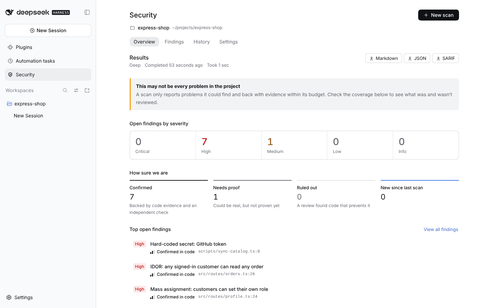
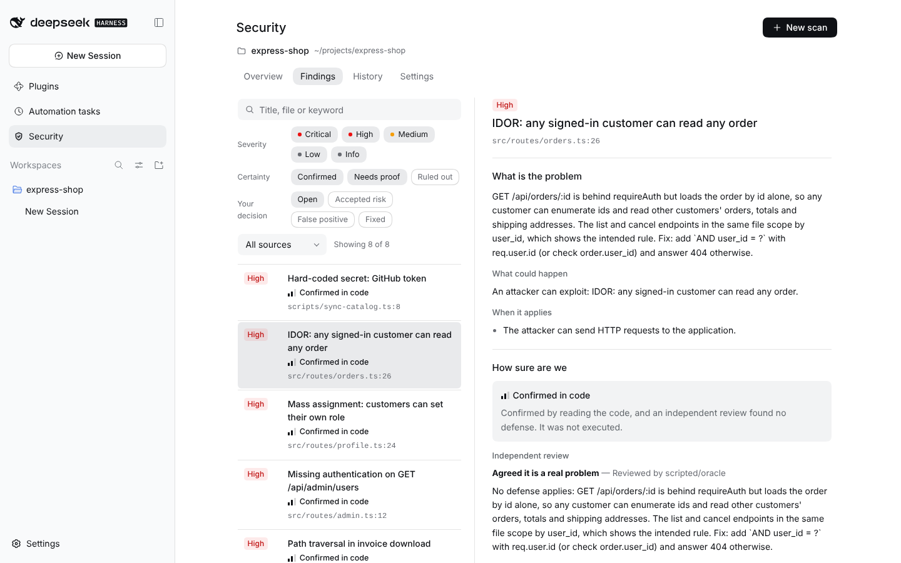

# DSH Security

[日本語](README.ja.md)

DSH Security is a security review plugin for [DeepSeek Harness](https://github.com/deepseek-ai/deepseek-harness)
(DSH 0.2.x). It adds a **Security** page to the DSH sidebar. A scan runs built-in analyzers over a read-only
snapshot of your project. AI reviewers then use the models you already connected in DSH to look for problems an
attacker could really use. Every AI claim must quote the exact code it relies on. The plugin checks each quote
against the snapshot and drops claims it cannot verify. An independent reviewer then tries to disprove each
finding. Results stay on your machine and can be exported as Markdown, JSON, or SARIF.




<sub>Screenshots: a Deep scan of the intentionally vulnerable fixture app `tests/fixtures/apps/express-shop`, run with
the deterministic test model from `tests/e2e/scripted-llm` (shown as `scripted/oracle`).</sub>

## What it does

- **Deterministic analyzers.** A secret scanner with 25 rules (it also does the redaction), 52 pattern rules for
  JavaScript/TypeScript, Python, Dockerfiles, Compose and Kubernetes, and endpoint discovery for Express, Fastify,
  Koa, Hono, NestJS, Next.js, Flask, FastAPI and Django. It also reads lock files for npm, PyPI, Go and Cargo.
  Optional extras: OSV.dev advisory lookups, plus Gitleaks, OSV-Scanner or Semgrep if they are installed.
  See [docs/analyzers.md](docs/analyzers.md).
- **Read-only multi-agent review.** A *Planner* builds a threat model, *Hunters* investigate endpoints, rule hits,
  sensitive files and the planner's hypotheses, and in Research mode a *Chain analyst* looks for combined attacks.
  The workers can only list, read and search files in the snapshot. They have no shell, no network access and no
  way to write files.
- **Host-verified evidence.** Every code citation is compared with the redacted snapshot. A citation counts as
  verified only if the quoted code is there. Findings with no verified step are discarded, and the number
  discarded is shown under Coverage.
- **Independent skeptic.** In Deep and Research mode, a separate worker sees only the claim and the verified code,
  not the hunter's reasoning, and tries to refute it. A refutation must cite the defending code; a confirmation
  must rest on verified code.
- **Reports and follow-up.** Triage decisions carry over to later scans of the same project. "Fix in DSH chat"
  hands a fix prompt to a normal DSH chat. Reports export as Markdown (English, Japanese or Chinese), JSON, or
  SARIF 2.1.0 for code-scanning dashboards.

## What it does not do

- It does not exploit anything, run your code, install your dependencies, or execute tests.
- It does not scan networks, hosts or running services. It reads source files only.
- **"0 findings" does not mean "safe".** A scan reports only what it found and could back with evidence within its
  budget. The Coverage section lists what was not reviewed.
- It is not a replacement for a professional security audit or penetration test. Results depend heavily on the
  model you choose, and both false positives and missed issues will occur.

## Quick start

1. **Install** the plugin. In the DSH Web UI, open **Plugins → Add plugin** and enter:

   ```text
   github:Aero123421/dsh-security-plugin#v0.4.2
   ```

   Or from a terminal (the `web` profile here):

   ```sh
   dsh plugin --profile web add -w github:Aero123421/dsh-security-plugin#v0.4.2
   ```

   Use the tag of the [release](https://github.com/Aero123421/dsh-security-plugin/releases) you want; without
   `#tag` you get the unreleased `main` branch. Each release also has a prebuilt
   `dsh-security-plugin-X.Y.Z.tgz` with `SHA256SUMS`, and its download URL works in the same places. The plugin is
   not published to npm. Enable it and restart DSH if asked. To confirm it is loaded, run
   `dsh --profile web --dump-config` and look for a `# == dsh-security-plugin` layer.

   To update, add the newer tag the same way. The *Settings* tab shows the running version.
2. **Open Security** in the DSH sidebar and choose a project. Use **Add project folder…** (when available) to
   register another folder in DSH’s project list and select it for scanning.
3. **Pick models** under the page's *Settings* tab → *Models*. A *Default* model is enough; each role (Planner,
   Hunter, Skeptic, Chain analyst) can override it. A scan needs at least a Hunter model, either its own or the
   default.
4. **New scan** → choose **Deep**, read the estimate (files, endpoints, planned AI tasks, token range), and tick the
   consent box. Your consent is saved in Security settings and applies to later scans until you turn it off.
5. **Start scan.** Progress, live workers and token usage appear on *Overview*. You can close the tab; the scan runs
   in the DSH Host. Pause, resume and cancel are on the same page. A scan that DSH interrupted by stopping can be
   resumed later.

## Reading the results

Each finding has two independent ratings. A critical issue can still be only "Possible".

| Severity (impact if real) | Verification (how well it is established) | Closure |
| --- | --- | --- |
| **Critical**: unauthenticated takeover or most data exposed | **Confirmed in code** (`strong_static_evidence`): the path was quoted from verified code and an independent review found no defense. A high-confidence hard-coded secret starts here too. | Confirmed |
| **High**: another user's or tenant's data, or sensitive data without login | **Possible** (`potential`): a rule hit or AI hypothesis nobody has confirmed yet | Needs proof |
| **Medium**: real but limited, or needs meaningful preconditions | **Undecided** (`inconclusive`): the review depends on facts outside the repository (deployment, configuration) | Needs proof |
| **Low**: minor impact or unlikely preconditions | **Ruled out** (`refuted`): a review cited verified code that prevents the attack | Ruled out |
| **Info**: notable but not exploitable | **Reproduced** (`proven_dynamic`): reserved for dynamic verification; code-only scans never assign it | Confirmed |

- **Closure** is derived from verification, so the two can never disagree. Open counts on *Overview* exclude ruled
  out findings and findings you triaged away.
- **Your decision** (Open, Accepted risk, False positive, Fixed) is stored per project and per finding fingerprint,
  so it carries over to later scans. Fingerprints ignore line numbers, so moving code does not reset decisions.
  Findings that were not in the previous completed scan are marked **New**.
- Every quoted step shows its check: *Quote verified*, *Verified, lines adjusted* (found once elsewhere in the same
  file), or *NOT VERIFIED*.
- **Fix in DSH chat** opens a new DSH chat for the same project with a fix prompt filled in: the finding, its
  verified code and the recommendation. Read it before you send it. The fix is made by your normal coding agent
  under its normal permissions; this plugin never edits code. *Copy fix prompt* copies the same text instead.
- **Run a Quick re-scan** after fixing to check whether the finding goes away.

## Scan modes

| | Quick | Deep (default) | Research |
| --- | --- | --- | --- |
| Threat model (Planner) | no | yes, up to 8 hypotheses | yes, up to 16 hypotheses |
| AI hunting | verifies medium-or-higher rule hits, file by file | endpoints, rule hits, planner hypotheses, up to 6 security-sensitive files | same as Deep |
| Independent review (Skeptic) | no | findings at or above *Second opinion from* (default Medium) | findings at Low or above |
| Attack chains | no | no | yes |
| **Default budget**: AI requests | 120 | 900 | 3,600 |
| Tokens | 1,200,000 | 9,000,000 | 36,000,000 |
| Minutes | 30 | 180 | 720 |
| Requests per reviewer | 36 | 72 | 120 |
| Review tasks | 18 | 120 | 450 |

Quick mode asks the AI only to confirm or dismiss rule hits. It does not look for logic flaws such as broken
authorization. If the built-in rules find nothing, Quick runs no AI tasks.

When an AI budget limit is reached, the scan stops starting new work, finishes, and lists what was skipped. Budgets
are editable per mode in Settings and are capped by the operator limits (see
[configuration](<docs/configuration.md>)). The time limit also bounds deterministic analysis and external tools:
if it expires during analysis, the scan remains interrupted with an incomplete-coverage gap, rather than claiming
completion. Resume re-analyzes within the original remaining time; start a new scan with a larger budget if needed.
Each scan keeps its models and budget. Turning off *Send code to the AI model* also stops the AI review of scans
that are queued, paused or running; new *Never send these files* patterns apply when a scan starts or resumes.
*Keep transcripts* is re-read at worker completion, so turning it off stops further transcript saves.

## Privacy and data flow

| What | Sent to | When |
| --- | --- | --- |
| Excerpts of your code read by AI workers, task descriptions (file paths, endpoint lists, rule-hit snippets) | The model providers you selected for each role, through DSH's own LLM registry and credentials | Only for AI scans, and only after you allowed *Send code to the AI model* |
| Package ecosystem, name and exact version from lock files | `https://api.osv.dev` or the operator's mirror | Only if *Look up known vulnerabilities online (OSV)* is on (off by default) |
| Download requests for pinned Gitleaks / OSV-Scanner builds | GitHub release URLs listed in `toolkit.lock.json` | Only when you click *Install* and accept the tool's license |
| Nothing else | | No telemetry, no analytics, no update checks |

Before anything reaches a model, it goes through these safeguards:

- Secrets found by the scanner are replaced with `[REDACTED:<rule-id>]` in every excerpt, and a stateless pass
  re-checks all tool output. Secret values are never stored; findings keep only a masked preview.
- **Withheld files** are never returned by the workers' tools (listing, reading, searching, quoting). Built in:
  `.env` and `.env.*` (except `.example`/`.sample`/`.template`), private keys and certificates, `.npmrc`, `.pypirc`,
  `.netrc`, `.git-credentials`, `.pgpass`, `.htpasswd`, AWS, Docker and Kubernetes client credentials
  (`.aws/credentials`, `.aws/config`, `.docker/config.json`, `.kube/config`, `kubeconfig`), service-account JSON,
  `secrets.y(a)ml`, Terraform state and `*.tfvars`. You can add
  your own patterns under *Never send these files*. Task descriptions follow the same rule: a rule hit in such a file
  is described by its path and rule id only, and routes declared or mounted there are not listed.
- The absolute project path is masked in every tool output.
- External analyzers run locally. OSV-Scanner runs offline unless OSV lookups are on. Semgrep runs only with local
  rules and with metrics off. The scanned project's own ignore settings for these tools (`.gitleaks.toml`,
  `osv-scanner.toml`, `nosemgrep` comments) are not honoured; Semgrep still applies a `.semgrepignore` file.

Redaction is pattern-based. A credential in a format the rules do not know can still reach the model, so add
withheld patterns for files that hold such values.

Data lives in `$DSH_HOME/security/` (by default `~/.dsh/security/`): `security.db` (scans, findings, evidence,
settings, triage, and AI transcripts unless you turn them off) and `toolkit/` (managed analyzer binaries). On
Linux and macOS the directory is created `0700` and the database `0600`. Scans older than 90 days are deleted at
startup; this is configurable.

## Configuration

Users change preferences in the Security page's *Settings* tab (also available in DSH Settings → Security).
Operators can set ceilings and paths in the profile's `cordis.patch.yml`, for example to forbid pages opened on
other machines from enabling code upload, or to point OSV lookups at a mirror. That rule is a policy for browser
pages, not an access control: anyone with the DSH credentials is the DSH operator. Every key, default and example is
in [docs/configuration.md](docs/configuration.md).

## Requirements and compatibility

- **DSH** `>=0.2.1-alpha.2 <0.3.0-0` with the Web UI (`dsh.client.platform: web`). DSH is an optional peer
  dependency and is never installed by this package.
- **Node.js** `^22.19.0 || >=24.0.0` (the store uses the built-in `node:sqlite`).
- At least one model provider connected in DSH whose models support tool calling.
- Linux, macOS or Windows. `@ast-grep/napi` is an optional dependency with prebuilt binaries for common platforms.
  Without it the plugin falls back to a built-in tokenizer with somewhat lower precision. Python ASTs use the
  grammar shipped in this package (Linux and macOS x64/arm64, Windows x64). On musl, the plugin does not read
  `parser.so` and uses `python-fallback`. This is a fail-safe change. A crash on musl was not reproduced on
  hardware. Not yet checked: an old-glibc machine, an arm64 machine, macOS, Windows, and whether `lib/` rebuilt
  from source matches the committed output. Known P3: at 360px or narrower, the page heading is truncated.
- Optional external tools: Gitleaks 8.19 or later (older versions use the legacy `detect` command), OSV-Scanner v2
  (v1 also works), Semgrep with a local rules file.

## Troubleshooting

| Symptom | Cause and fix |
| --- | --- |
| "No AI model is set up for scanning yet" (`security/no-model`) | Choose a Default or Hunter model under Settings → Models. The same error appears when a selected provider was removed from DSH. |
| "Scans need your permission to send redacted code" (`security/consent-required`) | Tick the consent box in the New scan dialog, or turn on Settings → *Privacy and safety* → *Send code to the AI model*. |
| "The host's operator only allows this from the host machine itself" (`security/forbidden-remote`) | The page is opened from another machine (or through a reverse proxy) and the operator set `allowRemoteHighRiskSettings: false`. Enable the setting from the Host machine itself. Turning settings off is always allowed. |
| "Another scan is already running" (`security/busy`) | A project can have only one queued or running scan, so the new scan was not created. Wait for the current one, or pause or cancel it on Overview, then start again. |
| Scan stays *Queued* | `maxConcurrentScans` (default 1) scans run at once across all projects; the rest wait in order. |
| Coverage → *Checks that didn't run* lists "ast-grep rules — native module unavailable on this platform" | `@ast-grep/napi` has no binary for this OS/CPU/libc, or optional dependencies were skipped during install. Scans still work with the built-in parser. Reinstall with optional dependencies to restore it. If `disableAstGrep: true` is set, this is expected. |
| Settings or Coverage says Python AST is unavailable and the built-in parser is used | On musl, the plugin does not read `parser.so` and uses `python-fallback`. This is a fail-safe change. A crash on musl was not reproduced on hardware. The same message is what Settings and Coverage show when the shipped grammar is not used. JavaScript and TypeScript still use ast-grep when `@ast-grep/napi` loaded. |
| `ExperimentalWarning: SQLite is an experimental feature` in the DSH log | Printed by Node 22 for `node:sqlite`. It is harmless. To hide it, start DSH with `NODE_OPTIONS=--disable-warning=ExperimentalWarning`. |
| Host log: "this DSH build has no exact-route support; the Security page is unavailable" | DSH is too old. Use a DSH version in the supported range. |
| Many findings "dropped because the code they cited couldn't be found" | The model is quoting code that does not exist. Use a stronger model for the Hunter role. |
| Notice: "The model provider refused some review requests" | The provider's content policy blocked the request. Those tasks are recorded as not reviewed, and no other model is tried automatically. |
| Settings → Analyzers shows no *Install* button and says "The managed download is not pinned yet" | This release has no checksum for that tool on your platform, so it will not download it. Install the tool yourself (the hint below it shows how) and put it on `PATH`; it is detected automatically. |
| Semgrep listed as unavailable: "no local semgrep rules were configured" | Set `semgrepConfig` to an absolute path of a rules file or directory. Registry rules are never fetched. |
| OSV-Scanner unavailable: "offline mode is on and no local osv-scanner database was found" | OSV lookups are off, so OSV-Scanner may only use a local database. Turn on OSV lookups or download a database with OSV-Scanner. |
| Scan *Interrupted* | DSH stopped while the scan was running. Press *Resume*; completed AI work is not repeated. |

## Development

```sh
pnpm install              # Node 22.19+ or 24+, pnpm 10.28 (see packageManager)
pnpm build                # lib/index.js (Host) and lib/client.js (browser)
pnpm lint                 # Biome
pnpm typecheck
pnpm test                 # Vitest: host (node) and client (happy-dom) projects
pnpm check                # all of the above plus the package verification
pnpm check:dsh            # latest DSH alpha (network): peer range, types, scratch web boot
```

- To try a checkout in DSH, run `pnpm install && pnpm build` in it, then
  `dsh plugin --profile web add /absolute/path/to/checkout`. Rebuild (`pnpm build:watch`) and restart DSH after
  changes.
- End-to-end runs without an API key use the deterministic test model in `tests/e2e/scripted-llm/`. See
  [docs/e2e-testing.md](docs/e2e-testing.md).
- `pnpm bench` scans the intentionally vulnerable fixture apps in `tests/fixtures/apps/` offline (built-in analyzers,
  and the scripted model for the AI path) and scores the results against their ground truth. See
  [docs/benchmark.md](docs/benchmark.md).
- Design: [docs/architecture.md](docs/architecture.md). Threat model of the plugin itself:
  [docs/security-model.md](docs/security-model.md). Releasing: [docs/releasing.md](docs/releasing.md).

Contributions are welcome; please read [CONTRIBUTING.md](CONTRIBUTING.md). Report vulnerabilities in the plugin
privately as described in [SECURITY.md](SECURITY.md).

## License

[MIT](LICENSE). Bundled and optional third-party components are listed in
[THIRD_PARTY_NOTICES.md](THIRD_PARTY_NOTICES.md).

## Acknowledgements

DSH Security is an independent community project. It is not affiliated with, endorsed by, or supported by
DeepSeek or the DeepSeek Harness maintainers.

Several open-source AI security projects shaped the design. Only ideas were taken; no code was copied:
[Strix](https://github.com/usestrix/strix) (counter-evidence and coverage tracking),
[Shannon](https://github.com/KeygraphHQ/shannon) (staged recon → analysis → verification),
[Cairn](https://github.com/oritera/Cairn) (workers sharing verifiable facts instead of a conversation),
[NeuroSploit](https://github.com/JoasASantos/NeuroSploit) (deterministic checks and cross-model validation), and
[Decepticon](https://github.com/BitterSecurity/Decepticon) (fresh context per worker and explicit safety
boundaries).
