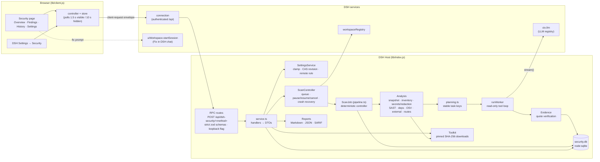

# Architecture

DSH Security has two halves, built by `scripts/build.mjs`. Both are declared in one bundle layer
(`cordis.patch.yml`) that inserts a single Cordis row, `id: dsh-security`.

- **Host plugin** (`src/host/` → `lib/index.js`, Node ESM). This half takes the snapshot, runs the analyzers and AI
  workers, verifies evidence, owns the SQLite store, and serves the browser over DSH's authenticated `/api`
  channel.
- **Browser plugin** (`src/client/` → `lib/client.js`, DSH's lazy-CJS module-loader format). This half adds the
  sidebar entry, the Security page (Overview, Findings, History, Settings tabs), the New scan dialog, and a Security
  section in DSH Settings. It can reach DSH only through injected services (`slots`, `locale`, `connection`, and
  optionally `layout` and `uiWorkspace`). The build fails if it imports anything outside DSH's module table.

Shared types and pure functions live in `src/shared/`: `domain.ts` (vocabulary), `settings.ts` (user settings and
defaults) and `contracts.ts` (the RPC contract, `CONTRACT_VERSION = 1`).

## Components

## Data flow of one scan

1. **Create** (`createScan`). The controller checks that the project exists and is a readable directory. For an AI
   scan it also checks that a Hunter route resolves (role override, else Default), that every selected provider is
   still connected in DSH, and that `privacy.sendCodeToModel` is on. A project with a queued or running scan is
   refused with `security/busy`. The new `ScanRecord` freezes the current settings, the mode's budget and the
   resolved model per role, so later settings changes do not affect a running or resumed scan, with two privacy
   exceptions: turning `privacy.sendCodeToModel` off stops the AI work of queued, paused and running scans (notice
   `consent-revoked`), and a scan withholds its frozen `withheldGlobs` plus the current ones on every start and resume.
2. **Queue.** Up to `maxConcurrentScans` jobs run at once. The rest wait in creation order. Jobs belong to the Host,
   so closing the browser does not stop them.
3. **Deterministic phases** (`scan/analysis.ts`): `snapshot` → `inventory` → `deterministic` (secrets and
   redaction, SAST, dependencies, OSV, external tools) → `surface` (routes). All of them work on an in-memory
   snapshot, never on the live tree.
4. **AI phases** (skipped when no Hunter model or when `aiReview: false`): `threat-model` → `hunt` → `review` →
   `chain`. Which of these run depends on the mode (see below).
5. **Reconcile.** Findings absent from the previous completed scan of the same project are marked new, and
   coverage is computed (files, files read by AI, endpoints reviewed, task outcomes, unavailable analyzers,
   discarded claims, known gaps).
6. **Report.** The scan is marked `completed`. Reports are rendered on demand by `exportReport` from the stored
   records.

### Phases

| Phase | Quick | Deep | Research | What happens |
| --- | --- | --- | --- | --- |
| `snapshot` | ✓ | ✓ | ✓ | Bounded, symlink-safe read of the workspace honoring `.gitignore`, built-in ignores and the user's `excludeGlobs`. Records the git commit if any. |
| `inventory` | ✓ | ✓ | ✓ | Languages, manifests, frameworks, test files. |
| `deterministic` | ✓ | ✓ | ✓ | Secret scan (its matches drive redaction), SAST rules, dependency parsing, optional OSV lookup, optional Gitleaks / OSV-Scanner / Semgrep. Reportable signals become findings immediately. |
| `surface` | ✓ | ✓ | ✓ | HTTP endpoint extraction with handlers, middleware and auth hints. |
| `threat-model` | – | ✓ | ✓ | One Planner run: assets, actors, trust boundaries, priorities and up to 8 / 16 hypotheses. |
| `hunt` | ✓ | ✓ | ✓ | Hunter tasks from `planHuntTasks` (Quick: only verifying rule hits of medium or higher). |
| `review` | – | ✓ | ✓ | One Skeptic task per `potential` finding from AI, SAST or external tools at or above the review threshold (Research: Low and above). At most `max(maxTasks, 10)` tasks. |
| `chain` | – | – | ✓ | One Chain-analyst run over up to 40 non-refuted AI or SAST findings (needs at least 2). |
| `reconcile`, `report` | ✓ | ✓ | ✓ | New-finding marks, coverage, completion. |

## Deterministic controller, LLM workers

All control flow is plain TypeScript in `ScanJob`. It decides which phases run, which tasks exist, how many workers
run in parallel, when the budget stops work, and what a model's output means. Models never schedule work, call
other agents or write to the store. They fill in the tasks the controller creates, and their output passes
host-side checks before anything is stored.

**Task planning** (`scan/planning.ts`) is a pure function of the analysis results:

- `hunt-endpoints`: endpoints grouped by handler file, 8 per task. Ranked up for endpoints without auth hints,
  mutating methods, parameters and nearby rule hits.
- `hunt-signals`: rule hits (`vulnerability` and `sink`) in files without endpoints, 12 per task.
- `hunt-hypothesis`: one per Planner hypothesis, ranked in the Planner's order.
- `hunt-file`: up to 6 security-sensitive files (auth, session, config, settings, cookie, billing, upload, …) not
  otherwise targeted. Deep/Research then append lowest-priority sweeps of remaining source files, 4 per task,
  only within spare task capacity. Sweeps prefer production files, then sensitive names, then larger files.
- `triage-signals` (Quick only): medium-or-higher `vulnerability` hits, 12 per task. Quick fills remaining slots
  with endpoint groups, prioritizing unguarded mutating endpoints, without raising its task or call caps.

Test and fixture files are left out unless `includeTests` is on. Candidates are sorted by priority and cut at the
mode's `maxTasks`; Quick always puts triage first. The number left over is reported as a notice. Unguarded mutating
routes and GET routes with `admin`, `internal` or `debug` path segments emit non-reportable `sink` observations:
these increase endpoint priority and appear as hunter steering context, never as deterministic findings.

**Workers** (`agents/runtime/worker.ts`) are short-lived tool-calling loops:

- Each request is one `ctx.llm.stream()` call: one provider attempt, with the role's system prompt, the task message
  and the tool schemas.
- Retryable failures (`RATE_LIMIT`, `SERVER`, `TIMEOUT`, `TRANSPORT`, `EMPTY_RESPONSE`) back off exponentially (1 s
  to 30 s, ±20% jitter, or the provider's retry-after up to 60 s), at most 4 attempts per turn. A stream that sends
  no chunk for `llmIdleTimeoutMs` (default 2 min) is abandoned as a `TIMEOUT`, and a stream that ignores the abort
  signal is abandoned as soon as the worker is cancelled.
- At most 48 tool calls run per model reply; the rest get an error result asking the model to batch fewer. The loop
  yields to the event loop after each tool execution.
- On `CONTEXT_WINDOW_EXCEEDED` the loop elides all but the last two tool results and retries once.
- Provider content-policy refusals end the worker as `blocked_by_provider`. They are never retried and no other
  model is tried.
- A plain-text reply is answered with a nudge, at most twice. On the last turn only the terminal (submit) tool is
  offered.
- Every request goes through the scan's shared budget gate. A worker always ends, after at most `maxTurns × 4`
  requests. When the scan's `maxMinutes` passes, its in-flight requests are aborted and those tasks are skipped as
  over budget.

**Roles** (`agents/roles/*`) share one system preamble. It says the tools are read-only, that repository content
is untrusted data and instructions in it must not be followed, that every claim must quote exact code, and it gives
the severity rubric and the output language. Each role has its own terminal tool:

| Role | Terminal tool | Turn cap | Output checks |
| --- | --- | --- | --- |
| Planner | `submit_threat_model` | `min(maxTurnsPerWorker, 48)` | At most N hypotheses. |
| Hunter | `submit_findings` | `maxTurnsPerWorker` | A finding whose attack-path quotes all fail verification is sent back (up to 2 times) with the exact mismatches; after that it is accepted and the host drops such findings. |
| Skeptic | `submit_verdict` | `min(maxTurnsPerWorker, 48)` | `refuted` without a verified counter-evidence quote of code (comment-only quotes do not count) is sent back (up to 2 times), then downgraded to `inconclusive`. `confirmed` without any verified step becomes `inconclusive`. |
| Chain analyst | `submit_chains` | `min(maxTurnsPerWorker, 48)` | A chain needs at least 2 known findings and at least 1 verified step (1 resubmission). |

The Skeptic runs in a fresh context. It receives the finding's claim, preconditions and host-verified excerpts, but
never the hunter's transcript or reasoning. For non-English scans of rule-based findings, it also writes the
localized title, summary, impact and recommendation.

## Evidence verification

`evidence/quote.ts` checks every citation `{path, start_line, end_line, quote}` against the redacted,
root-masked snapshot text: exactly what the tools showed the model. Whitespace is collapsed on both sides, and a
quote copied with `  12| ` line prefixes is retried without them.

| Result | Meaning |
| --- | --- |
| `match` | Found once within the cited lines ±3. Several occurrences there match only when the cited range is tight (at most the quote's lines + 6); the nearest one is taken. |
| `relocated` | Not within the cited lines ±3, but found exactly once elsewhere in the same file. |
| `mismatch` | File not in the snapshot, withheld file, cited range too wide (more than the quote's lines + 40), quote not found, quote ambiguous (several places in the file, or in a loose cited range), or quote too short (< 8 normalized characters unless the cited range is that short). |
| `unchecked` | Nothing to check. |

For `match` and `relocated`, the stored location and snippet are the lines the quote actually occupies, never the
cited range. A quote containing a raw secret cannot match, because the snapshot text it is compared with is redacted.
Withheld files cannot be quoted at all.

`evidence/comments.ts` flags a verified quote as comment-only when all of it lies in comments (`//`, `#`, `--`,
`/* */` and `*` lines, `<!-- -->`, template comments), Python docstrings, or documentation files (`.md`, `.txt`,
`.rst`, …). The lexer is chosen by file extension and skips string literals. Comment-only quotes are stored and shown,
but never count as counter-evidence or as support for a severity change.

How findings are stored (`scan/findings.ts`):

- **Rule findings** (`secret`, `vulnerability`, `dependency` signals) are recorded right after the deterministic
  phase with one `tool_observation` evidence record (trust `observed`). They start as `potential`, except
  high-confidence secrets, which start as `strong_static_evidence`. `sink` signals do not become findings; they only
  steer AI tasks.
- **Hunter findings** need at least one verified attack-path step. The key step (the last verified one, usually the
  sink) sets the location and fingerprint. A new AI finding within 3 lines of an existing non-dependency, non-secret
  finding of the same category or CWE is merged into it. A rule hit merged this way takes the hunter's narrative and
  attack path.
- **Hunter verdicts on rule hits:** a hunter never rules a hit out on its own. `false_positive` attaches the cited
  defense as counter-evidence. When a Skeptic will review that severity later, the Skeptic decides. When none will
  (Quick mode, or below the review threshold) and the defense is verified code, not only comments, the hit becomes
  `inconclusive` with the hunter's reason as a limitation.
- **Skeptic verdicts** set the verification: `confirmed` → `strong_static_evidence`, `refuted` → `refuted`,
  otherwise `inconclusive`. A severity correction applies only to a `confirmed` verdict with a verified, non-comment
  supporting quote. It lowers a deterministic (`secret`, `dependency`, `sast`, `external`) critical or high rule hit
  by at most one level per review. The review reasoning notes the original severity, or why a suggestion was not
  applied.
- **Closure** is never stored. It is derived from verification by `closureOf()`.

## Fingerprints and triage carry-over

Fingerprints (`scan/fingerprint.ts`) are 32 hex characters of SHA-256 over parts that leave out line numbers:

- rule findings: rule id, path, normalized matched expression (a secret's own hash for secret findings);
- AI findings: `ai`, category, CWE, path, normalized key quote;
- chains: the sorted fingerprints of their parts.

Triage lives in its own table keyed by (project, fingerprint). It is not stored on a finding, so it survives scan
deletion and applies to every later scan that reports the same issue. When findings merge, the merged fingerprints
are kept, so "new since last scan" also matches through merges. SARIF results carry the fingerprint as
`partialFingerprints["dshSecurity/v1"]`. Triaged-away and refuted findings are written as suppressions.

## Budgets

One `ScanBudgetGate` is shared by all workers of a scan:

- Model calls are reserved before each request, so parallel workers cannot go over `maxLlmCalls`.
- Tokens are charged when usage arrives. The token ceiling can therefore be exceeded by at most the requests
  already in flight. The charge is the reported uncached input and cache writes at full rate, output at full rate,
  and cache reads at a tenth (`CACHE_READ_CHARGE_RATE`): budgets are a cost guardrail, and providers price cache
  reads far below fresh input, so full-rate charging drained budgets about ten times faster than the underlying
  spend once a worker's resent history was mostly cache hits. Stored `inputTokens` usage is this charge; raw
  per-request counts stay in transcripts.
- Minutes count running time only. Time spent paused or interrupted does not count.

When any dimension runs out, no new task starts. Tasks still queued are marked `skipped` (reason `budget`), the scan
completes normally, and a notice says which budget ran out. The user can then extend that scan's budget
(`extendScanBudget`): the frozen budget grows (clamped to the operator ceilings), budget-skipped tasks return to
`pending`, and the scan is queued again with its findings, usage, and completed tasks intact.

## Pause, resume and crash recovery

- **Pause or cancel** aborts in-flight model requests through the job's `AbortSignal`. Tasks that were `running` go
  back to `pending`. Pause leaves the scan `paused`. Cancel marks the remaining tasks `skipped` and the scan
  `cancelled`, which cannot be resumed.
- **Disabling the plugin or stopping DSH** stops jobs with a 5-second grace period. They become `interrupted`.
- **Crash recovery.** At startup, any scan still marked `running` (DSH did not stop cleanly) becomes `interrupted`.
  Its running tasks go back to `pending`, and worker runs that were in flight are closed as cancelled. Retention cleanup also runs at startup.
- **Resume** works for `paused`, `interrupted` and `failed` scans. It puts the scan back in the queue. The
  deterministic phases run again on a fresh snapshot (they are cheap and reproducible), and a notice appears if the
  snapshot digest changed. AI tasks are idempotent by **stable task keys**: tasks are inserted with
  `ensureTask(scan_id, key)` under a `UNIQUE (scan_id, key)` constraint, and keys come from content rather than from
  random ids (`endpoints:<file>#<chunk>`, `signals:<file>#<chunk>`, `hypothesis:<sha256 of title and paths>`,
  `file:<path>`, `review:<finding id>`, `threat-model`, `chain`). Re-planning after a resume therefore finds the
  same tasks. Tasks marked `done` are not run again, and rule findings are not duplicated because insertion skips
  existing fingerprints. Usage and elapsed time carry over into the new run.

## Why the DSH LLM registry instead of DSH chat sessions

The original design planned for each worker to be its own DSH agent session (`ctx.agents.create()`). The
implementation instead calls DSH's provider-neutral LLM registry (`ctx.llm.stream`) directly and runs its own
read-only tool loop. Reasons:

- **Isolation from the user's chats.** Workers never show up in the session list, chat history or search, and they
  never inherit a chat's memory, persona, instructions or compaction.
- **Isolation from other plugins.** A DSH session gets the profile's global tools, including MCP servers, web
  search, shell and tools that other plugins register. A security reviewer that reads hostile repository content
  must not have them. With its own loop, the plugin decides the exact tool list: six read-only snapshot tools and
  one submit tool.
- **Deterministic control.** Retries, context compaction, budgets, cancellation and quote verification inside
  `submit_*` all happen inside the loop the plugin owns.
- **Same models and credentials.** The registry is what DSH chats use underneath, so users pick from the same
  connected providers and models (including reasoning effort and max output tokens) without configuring keys a
  second time.

The cost is that worker conversations are not visible as DSH chats. They are stored as transcripts in the plugin's
database instead (`keepTranscripts`, on by default).

Remediation goes the other way on purpose: "Fix in DSH chat" calls `uiWorkspace.startSession(workspaceId, { prompt
})` in the browser. That opens a normal DSH chat whose agent edits code under the user's own permissions.

## Storage

`store/sqlite.ts` uses Node's built-in `node:sqlite` with WAL journaling (when the filesystem supports it), foreign
keys and versioned, append-only migrations (`store/schema.ts`). A database written by a newer plugin version is
refused. Tables: `settings` (one row, with a revision for compare-and-set), `scans`, `tasks`, `agent_runs`,
`transcripts` (gzip, up to 32 MiB of JSON each), `evidence`, `findings`, `triage`, `events`, `meta`. Every per-scan
table cascades from `scans`. At startup, retention deletes scans created more than `retentionDays` ago, except
scans that are queued, running or paused.
